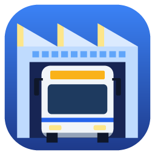

# OMNATORIA – Bus Company Simulator

**Plane. Fahre. Wachse.** · Busbetrieb für [openOMSI](https://github.com/turbo-devv/openOMSI)

🇩🇪 **Deutsch** · 🇬🇧 [English](README.en.md)

Leite deinen eigenen Busbetrieb auf einer OMSI-2-Karte – und fahr die Dienste selbst in
[openOMSI](https://github.com/turbo-devv/openOMSI).

Du disponierst Busse und Fahrer auf die echten Umläufe der Karte, hältst den Fuhrpark mit
Tankstelle, Waschanlage und Werkstatt am Laufen, gewinnst Ausschreibungen und behältst die Finanzen
im Blick. Jeden Dienst kannst du der Simulation überlassen oder selbst übernehmen: Der Simulator
startet openOMSI direkt mit deinem Bus, deiner Linie und deinem Umlauf und läuft im Gleichschritt
mit. Mit Freunden betreibt ihr den Hof gemeinsam – mit Rollen, Betriebsfunk und gemeinsamem
openOMSI-Server.

---

## Inhalt

- [Voraussetzungen](#voraussetzungen)
- [Installation](#installation)
- [Features](#features)
- [Selbst fahren in openOMSI](#selbst-fahren-in-openomsi)
- [Gemeinsam spielen](#gemeinsam-spielen)
- [Was der Simulator an deiner Installation macht](#was-der-simulator-an-deiner-installation-macht)
- [Fragen und Probleme](#fragen-und-probleme)

## Voraussetzungen

- **Windows 10 oder 11**
- **OMSI 2** (Steam) – der Simulator liest daraus Karten, Fahrpläne und Busse
- **openOMSI** – nur, wenn du selbst fahren willst

Mitspieler ohne OMSI 2 können trotzdem beitreten und disponieren.

## Installation

1. Unter [Releases](../../releases/latest) die `omnatoria.exe` herunterladen.
2. In einen beliebigen Ordner legen und starten – eine Installation gibt es nicht.
3. Der Simulator sucht OMSI 2 und openOMSI selbst. Findet er OMSI 2 nicht, wähle den Ordner, in dem
   `maps` und `Vehicles` liegen.

Beim ersten Start wählst du die **Sprache** (Deutsch oder Englisch). Ändern lässt sie sich jederzeit
über die Flaggen oben rechts im Hauptmenü oder unter ⚙ Einstellungen.

Eine **Einführungstour** (Einzel- oder Mehrspieler) zeigt dir beim ersten Start Schritt für Schritt
alle Knöpfe und Reiter.

**Updates** kommen von selbst: Beim Start fragt der Simulator hier nach einer neuen Version, zeigt
die Neuerungen und tauscht auf Klick die Programmdatei aus – geprüft gegen die SHA-256-Prüfsumme
von GitHub. Deine Betriebe bleiben dabei unverändert.

## Features

### Dein Betrieb

- **Jede OMSI-2-Karte** mit Fahrplan, auch Karten aus openOMSI-Mods. Umläufe, Fahrten,
  Haltestellen, Wagennummern und Kennzeichen kommen aus der Karte.
- **Karriere** – eigener Betrieb mit Name und Logo, ein Umlauf und Geld für einen gebrauchten Bus.
  Wachse über Ausschreibungen, Betriebsstufen und Tagesziele.
- **Freies Spiel** – voller Hof mit allen Bussen, Fahrern und Linien der Karte.
- **Drei Schwierigkeitsgrade** – bei „Realistisch“ zahlst du den aktuellen Dieselpreis an der Säule.
- **Echtes Datum** mit Feiertagen und Schulferien deines Bundeslands. Umläufe fahren nur an ihren
  Verkehrstagen, und openOMSI bekommt dasselbe Datum.
- **Mehrere Betriebe** nebeneinander, mit Übersicht im Hauptmenü.
- **Deutsch und Englisch** – die ganze Oberfläche, Meldungen, Dienstzettel und die Tafel in openOMSI.

### Disposition und Fahrbetrieb

- Busse auf Umläufe und Fahrer auf Dienste verteilen – von Hand oder automatisch, mit Ruhezeiten,
  Arbeitszeitgrenzen, Gelenkbus-Schein und Typeinweisungen.
- **Bus je Dienst**: An der Ablösung übernimmt auf Wunsch ein anderer Bus.
- **Ablösungen unterwegs** mit Nachrichten der Leitstelle für die beteiligten Spieler.
- **Störungen**: Baustellen, Umleitungen, Unfälle und Polizeieinsätze verspäten Linien. Dagegen
  helfen Springer oder gestrichene Fahrten.
- **Pannen und Mängel**: Busse verschleißen. Fahrer finden Mängel bei der Abfahrtskontrolle oder
  unterwegs, schwere Mängel legen den Bus still.
- **Leihfahrer-Agentur**, wenn ein Dienst keinen Fahrer hat.
- **Live-Karte** mit Straßen, Liniennetz und jedem Bus auf der Strecke, Spieler mit ihrer echten
  Position aus openOMSI.

### Fuhrpark und Betriebshof

- **Hofplan** mit Tankstelle, Waschanlage und Werkstatt, mit begrenzten Plätzen und Warteschlangen.
- Busse **gebraucht kaufen, neu ab Werk, leasen oder mieten** – jeder installierte Bus, auch aus
  Mods, mit Lackierung nach Wahl.
- Hauptuntersuchung, Inspektion, Reparaturen und automatische Werkstatt.
- **Werbeflächen** an den Bussen bringen tägliche Einnahmen.
- **Ausbau**: mehr Stellplätze, Zapfsäulen, Waschstraßen und Werkstattgruben.

### Personal und Fahrgäste

- Bewerbungen, Löhne, Urlaubsanträge, Zufriedenheit und Krankmeldungen.
- Schulungen: Gelenkbus-Schein, Typeinweisung, Fahrgastservice, spritsparendes Fahren.
- **Fahrkartenkontrolleure** gegen Schwarzfahrer.
- **Ruf von 0 bis 5 Sternen**: Beschwerden und Lob von Fahrgästen, mehr Fahrgäste und ein
  Qualitätsbonus bei gutem Ruf.

### Finanzen

- Kilometergeld des Aufgabenträgers, Fahrgeld, Bußgelder und Werbung, dazu Kosten für Diesel,
  Personal, Werkstatt und Hof – alles aufgeschlüsselt nach Posten.
- **Ausschreibungen** gegen Mitbewerber, mit Laufzeit und Preis je Kilometer.
- Kredite, Leasing und Miete; Vertragsstrafen bei Ausfällen.

## Selbst fahren in openOMSI

- **Ein Klick startet openOMSI** mit Karte, Bus (Wagennummer, Kennzeichen, Lackierung,
  Verschmutzung), Hof-Datei, Linie, Umlauf, Uhrzeit, Datum und deinem Fahrerprofil – ohne Launcher
  und Menü.
- **Uhr im Gleichschritt**: Die Simulation läuft mit der Uhr von openOMSI weiter. Pause und
  Zeitraffer gelten für beide.
- **Tafel im Spiel**: Fahrt, nächste Haltestellen mit erwarteter Zeit, Abstand zum Bus davor und
  dahinter, Nachrichten der Leitstelle und Störungen auf deiner Linie. Mit Knöpfen meldest du dich
  bei der Leitstelle oder meldest einen Mangel.
- **Mängel im Bus spürbar**: Türen, die wieder aufgehen, Motor im Notlauf, ausgefallene
  Lichtmaschine, defekter Blinker oder defektes Abblendlicht.
- **Echte Fahrscheine**: Was du im Bus verkaufst, zählt zu den Einnahmen, zu den Preisen der Karte.
- **Fahrtenprotokoll**: Verspätung und gefahrene Fahrten übernimmt der Simulator aus openOMSI.
- **Vorzeitig aufhören**: Wenn die Schicht zu lang ist, fährt die Simulation den Rest.
- **Leben**: ein eigenes Konto mit Lohn, Wohnung, Auto, Freizeit, Erholung und Laune.

## Gemeinsam spielen

- **Beitreten per Code** – ohne Steam, ohne Portfreigabe. Über Cloudflare bleibt die IP-Adresse
  des Chefs verborgen.
- **Rollen**:
  - Der *Chef* entscheidet über Kauf, Personal und Linien.
  - *Disponenten* teilen Busse und Fahrer ein.
  - *Fahrer* tragen sich für Dienste ein.
- **Betriebsfunk** mit Sprechtaste, Vorrang der Leitstelle, Einzelruf und Sprechwunsch. Die Tasten
  funktionieren auch, während openOMSI im Vordergrund ist.
- **Gemeinsamer openOMSI-Server**: Der Simulator startet ihn mit Karte, Datum und Uhrzeit des
  Betriebs. Alle fahren in derselben Welt.
- **Personalakten** zeigen, wer pünktlich zum Dienst erscheint.

## Was der Simulator an deiner Installation macht

- **OMSI 2 wird nur gelesen**: Karten, Fahrpläne, Busse, Lackierungen, Fahrscheinpakete.
- In **openOMSI** legt der Simulator nur eigene Dateien an:
  - das Plugin `Plugins\betriebshof.lua` (Uhrzeit, Tafel, Fahrscheine, Mängel) mit seinem
    Datenordner;
  - bei Bedarf eine ergänzte `Holidays.txt` im eigenen Kartenordner von openOMSI.

  Fremde Dateien überschreibt er nie, vorhandene Fahrerprofile auch nicht.
- Spielstände, Profile und Einstellungen liegen unter `%APPDATA%\OMNATORIA`.

## Fragen und Probleme

Fehler gefunden oder eine Idee? Schreib ein [Issue](../../issues). Hilfreich sind dabei:

- die Version (steht im Hauptmenü oben rechts);
- die Karte und der Bus;
- was du gemacht hast und was passiert ist.

---

© 2026 Nebomuck. Alle Rechte vorbehalten – siehe [LICENSE.md](LICENSE.md).
OMSI 2 ist ein Produkt von MR-Software / Aerosoft, openOMSI ein eigenständiges Projekt. Der
OMNATORIA steht mit keinem von beiden in Verbindung.
